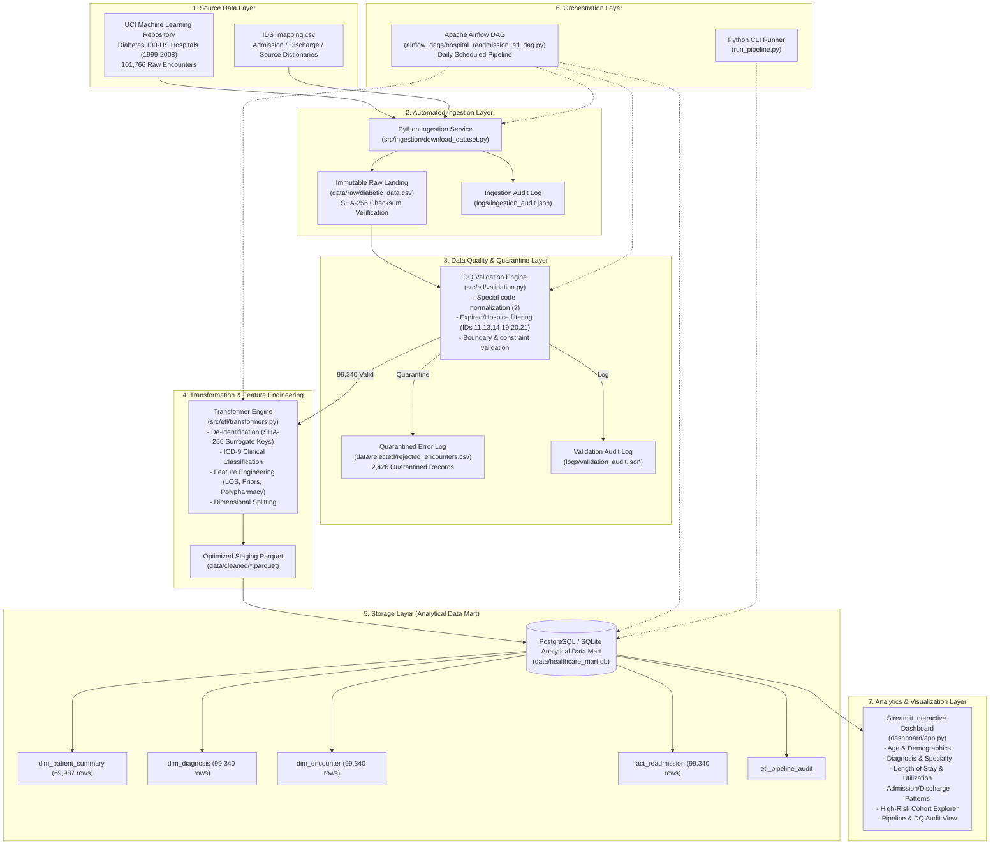

# Healthcare Readmission ETL & Analytics Architecture

## 1. End-to-End System Architecture

---

## 2. Pipeline Execution Layers

1. **Source Layer**: Acquires 101,766 de-identified clinical encounter records across 130 US hospitals spanning 10 years (1999?2008).
2. **Ingestion Layer**: Downloads, verifies file SHA-256 signatures, preserves immutable raw CSV snapshots, and parses lookup tables.
3. **Validation & Quality Layer**: Filters 2,426 invalid/hospice/expired records where 30-day readmission is clinically impossible, recording explicit rejection reasons in `data/rejected/rejected_encounters.csv`.
4. **Transformation Layer**:
   - Generates privacy-preserving SHA-256 surrogate keys (`PAT_...`, `ENC_...`).
   - Translates ICD-9 codes into 17 high-level clinical categories.
   - Computes utilization metrics, medication change flags, and 30-day readmission indicators.
5. **Storage Layer**: Star-schema data mart (`dim_patient_summary`, `dim_diagnosis`, `dim_encounter`, `fact_readmission`) hosted in PostgreSQL / SQLite.
6. **Orchestration Layer**: Airflow DAG + one-click Python runner (`run_pipeline.py`).
7. **Visualization Layer**: Multi-view Streamlit dashboard with interactive filtering and cohort drill-downs.
